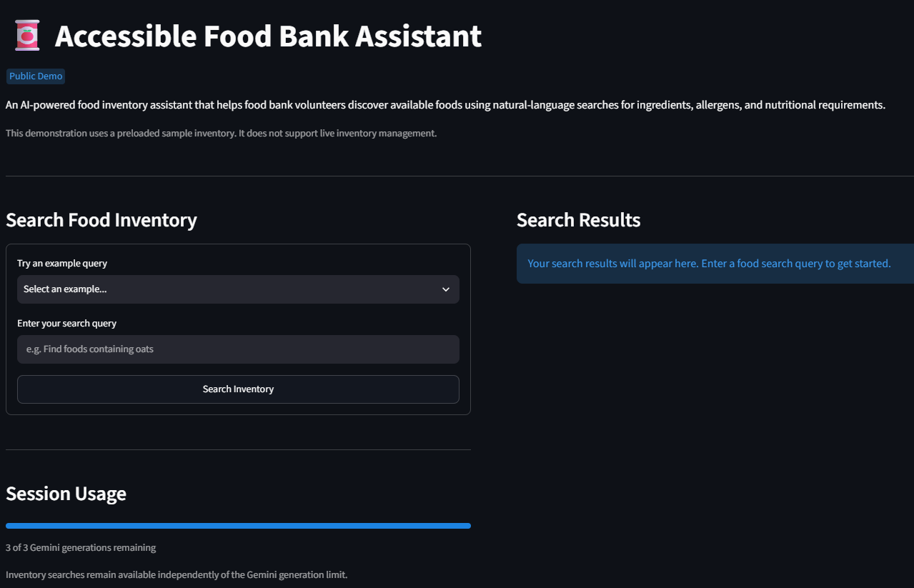
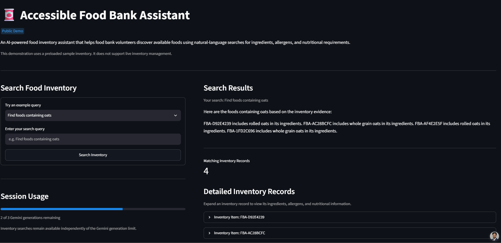
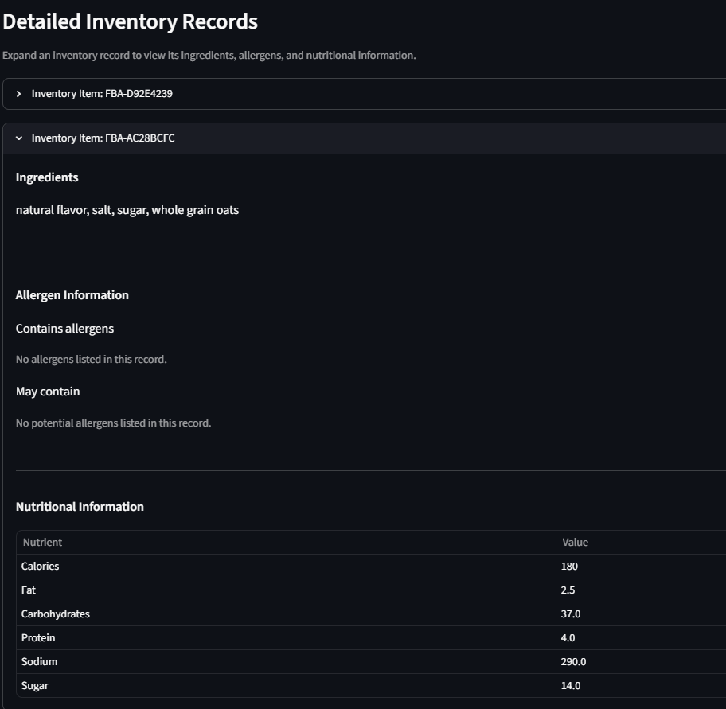
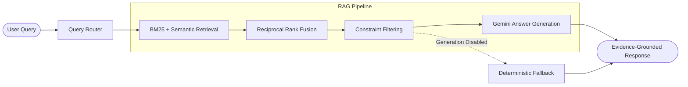

# 🥫 Accessible Food Bank Assistant


<p align="center">
  
  
</p>

<p align="center">
  
  
  
  
  <br>
  
</p>

<p align="center">
  
  
  
</p>


Making donated food inventory easier to search and understand with AI.

Accessible Food Bank Assistant is an AI-powered application that transforms food-label information into structured inventory records and helps food bank volunteers discover products through natural-language queries.

Volunteers can ask questions such as:

- Which foods contain soy?
- Find items with more than 10g of protein.
- Which products are low in sugar?
- Which foods contain wheat?

The application searches an existing food inventory, applies dietary and nutritional constraints, and provides responses grounded in retrieved inventory evidence.

🚀 **[Try the Live Demo](https://foodbankassistant.streamlit.app/)**

## Application Preview
<table>
  <tr>
    <td width="50%">
      
      <br><br>
      
    </td>
    <td width="50%" valign="middle">
      
    </td>
  </tr>
</table>

## Key Features

- **Gemini-powered food extraction:** Extracts ingredients, allergens, and nutrition information from food labels.
- **Structured inventory:** Stores normalized food information and unique inventory identifiers.
- **Hybrid retrieval:** Combines BM25 keyword search with semantic search using Sentence Transformers.
- **Query routing:** Recognizes ingredient, allergen, and nutrition-related queries.
- **Constraint-aware search:** Applies dietary and numeric constraints, including allergen exclusions and nutritional thresholds.
- **Evidence-grounded responses:** Uses Gemini for natural-language answer generation with a deterministic fallback.
- **Streamlit interface:** Provides an interactive interface for searching the existing inventory.
- **Usage safeguards:** Implements session query limits, a daily Gemini generation budget, request timeouts, and read-only public demonstration safeguards.

## How It Works

### Food-label extraction


**Note:** Image-based inventory intake is outside the scope of the public demonstration. The extraction pipeline is implemented and evaluated separately.

### Natural-language search



The Query Router identifies ingredient, allergen, and nutrition-related queries.

The retrieval pipeline combines BM25 and semantic search, followed by Reciprocal Rank Fusion (RRF) and constraint filtering.

Gemini optionally generates a natural-language response using retrieved evidence. When generation is disabled or unavailable, the application uses a deterministic response formatter without requiring an LLM.

### Main Components

| Component | Purpose |
|---|---|
| Google Gemini API | Food-label extraction and optional answer generation |
| BM25 | Keyword-based retrieval |
| Sentence Transformers | Semantic embeddings using `all-MiniLM-L6-v2` |
| ChromaDB | Persistent vector storage |
| Reciprocal Rank Fusion | Combines keyword and semantic rankings |
| Constraint Filters | Applies ingredient, allergen, and nutrition constraints |
| Streamlit | User-facing application |
| Pytest | Automated testing |

## Evaluation

The project has been evaluated across food-label extraction, query routing, retrieval quality, response latency, and synthetic database scaling.

### Food-label Extraction and Retrieval

| Component | Metric | Result |
|---|---|---:|
| Gemini 3.5 Flash Lite | Ingredient Extraction F1 | 0.7950 |
| Gemini 3.5 Flash Lite | Allergen Detection F1 | 0.7527 |
| Gemini 3.6 Flash | Ingredient Extraction F1 | 0.8404 |
| Query Router | Accuracy | 100% |
| Hybrid Retrieval | Precision@5 | 0.9600 |
| Hybrid Retrieval | Recall@5 | 0.5073 |
| Hybrid Retrieval | MRR@5 | 1.0000 |
| Hybrid Retrieval | nDCG@5 | 0.9723 |

Metrics reflect the corresponding evaluation datasets and relevance judgments.

### Application Latency (105 Records)

Measured warm `ConversationService.ask()` execution across five query categories (30 runs each).

| Query Category | Average (ms) | P95 (ms) |
|---|---:|---:|
| Ingredient | 0.636 | 0.846 |
| Allergen | 0.594 | 0.762 |
| Nutrition | 0.647 | 0.974 |
| Semantic | 231.575 | 257.992 |
| Hybrid | 192.980 | 218.350 |

**Gemini-enabled tests:** 3 API calls recorded total response times of 1.12–1.96 seconds; 2 responses passed evidence validation, while 1 was rejected by the validation safeguard.

### Synthetic Database Scalability

Evaluated BM25, semantic, and hybrid retrieval across progressively larger synthetic inventories using 10 judged queries and 20 measured runs per query.

| Inventory Size | BM25 (ms) | Semantic (ms) | Hybrid (ms) |
|---:|---:|---:|---:|
| 1,000 | 1.30 | 19.42 | 23.45 |
| 2,500 | 1.41 | 5.85 | 8.49 |
| 5,000 | 3.07 | 5.84 | 9.90 |
| 10,000 | 7.60 | 6.85 | 16.92 |

*Benchmark configuration: all-MiniLM-L6-v2, retrieval-k=20, top-k=5, RRF k=60, and 3 warmup runs.*

**Observations:** BM25 and hybrid retrieval latency increased at larger inventory sizes, while semantic retrieval remained relatively stable beyond the 1,000-record experiment. The 1,000-record semantic result was an outlier, so the measurements should not be interpreted as a strictly monotonic scaling trend.

*Note: Application latency measurements were collected locally on Windows 11 with Python 3.12.10, not from the deployed Streamlit Cloud runtime. Synthetic scaling experiments used isolated indexes and did not modify production inventory data.*

**Limitations:**

- Synthetic records were derived from existing inventory records with variations in nutritional values. They do not represent independently collected real-world food products.
- Synthetic records did not have independent human relevance judgments. Precision calculations use only retrieved records with available human labels, and judgment coverage is reported separately.
- All scaling experiments used isolated ChromaDB indexes. Production inventory and production vector storage were not accessed or modified.

## Run Locally

### 1. Clone the repository

```bash
git clone https://github.com/ANIRUDH-R2911/accessible-food-bank-assistant.git
cd accessible-food-bank-assistant
```

### 2. Create and activate the virtual environment

The project has been validated with Python 3.12.

```powershell
py -3.12 -m venv venv
.\venv\Scripts\Activate.ps1
```

### 3. Install dependencies

```bash
python -m pip install --upgrade pip
pip install -r requirements.txt
pip install -r requirements-dev.txt
```

### 4. Verify installation

```bash
python --version
pip check
```

Expected Python version: Python 3.12.x.

### 5. Configure environment variables

Create a `.env` file in the project root:

```env
GEMINI_API_KEY=your_gemini_api_key
GEMINI_ANSWER_GENERATION_ENABLED=false
```

Set `GEMINI_ANSWER_GENERATION_ENABLED=true` to enable Gemini-powered answer generation.

Keep your API key private and never commit the `.env` file.

### 6. Launch the application

```bash
python -m streamlit run app/streamlit_app.py
```

### 7. Run the automated tests

```bash
python -m pytest tests/ -v --ignore=tests/test_gemini_pipeline.py
```

The Gemini pipeline integration test is excluded from the default test run because it requires a valid Gemini API key and can modify persistent inventory data.

Run it separately only when intentionally testing the live extraction pipeline:

```bash
python -m pytest tests/test_gemini_pipeline.py -v
```

## Deployment & Safety

The application is deployed on Streamlit Community Cloud and configured for **read-only inventory search**.

- Session query limits, query-length limits, and a daily Gemini generation budget.
- Gemini answer generation disabled by default, with request timeouts and no repeated SDK retries.
- Cached initialization that reuses the existing ChromaDB collection instead of re-indexing.
- No public upload workflow that can modify inventory records; food-label extraction is kept separate from public search.
- Generated answers grounded in retrieved inventory evidence, with missing nutritional values never assumed.

