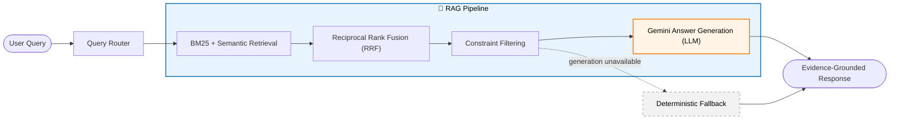

# 🥫 Accessible Food Bank Assistant

Making donated food inventory easier to search and understand with AI.

Accessible Food Bank Assistant is an AI-powered application that turns food-label information into structured inventory records and helps food bank volunteers find products through natural-language queries.

Volunteers can ask questions such as:

- Which foods contain soy?
- Find items with more than 10g of protein.
- Which products are low in sugar?
- Which foods contain wheat?

The application searches an existing food inventory, applies relevant dietary and nutritional constraints, and can generate answers grounded in the retrieved inventory evidence.

## Key Features

- **Gemini-powered food extraction:** Extracts ingredients, allergens, and nutrition information from food labels.
- **Structured inventory:** Stores normalized food information and unique inventory identifiers in a JSON-backed inventory.
- **Hybrid retrieval:** Combines BM25 keyword search with semantic search using Sentence Transformers.
- **Query routing:** Recognizes ingredient, allergen, and nutrition-related queries.
- **Constraint-aware search:** Applies dietary and numeric constraints, such as protein greater than 20g.
- **Evidence-grounded responses:** Uses Gemini to generate natural-language answers from retrieved inventory evidence, with a deterministic fallback when generation is unavailable.
- **Streamlit interface:** Provides a conversational interface for searching the existing inventory.
- **Usage safeguards:** Includes query limits, a daily Gemini generation budget, request timeouts, and protections against unintended changes to the persistent inventory during public demonstrations.

## How It Works

### Food-label extraction

```text
Food Label → Gemini Extraction → Schema Validation → Ingredient & Allergen Normalization → Structured Inventory
```

> **Note:** Image-based inventory intake is currently outside the scope of the public demo. The existing extraction pipeline is implemented and evaluated separately. A volunteer-facing intake workflow demo may be introduced in a future version.

### Natural-language search



The Query Router runs before the RAG stage and recognizes ingredient, allergen, and nutrition-related queries. Inside the **RAG pipeline**, retrieval and constraint filtering find the relevant inventory evidence without an LLM, and **Gemini** (highlighted in orange) generates the natural-language answer from that evidence. When generation is disabled or unavailable, the **deterministic fallback** returns a response built directly from the retrieved results, with no LLM involved.

### Main components

| Component | Purpose |
| --- | --- |
| Google Gemini API | Food-label extraction and optional answer generation |
| BM25 | Keyword-based retrieval |
| Sentence Transformers | Semantic embeddings using `all-MiniLM-L6-v2` |
| ChromaDB | Persistent vector storage |
| Reciprocal Rank Fusion | Combines keyword and semantic search rankings |
| Constraint filters | Applies ingredient, allergen, and nutrition constraints |
| Streamlit | User-facing search interface |
| Pytest | Automated unit and integration testing |

## Evaluation

The project has been evaluated across food-label extraction, query routing, and retrieval quality.

| Component | Metric | Result |
| --- | --- | --- |
| Gemini 3.5 Flash Lite | Ingredient Extraction F1 | 0.7950 |
| Gemini 3.5 Flash Lite | Allergen Detection F1 | 0.7527 |
| Gemini 3.6 Flash | Ingredient Extraction F1 | 0.8404 |
| Query Router | Accuracy | 100% |
| Hybrid Retrieval | Precision@5 | 0.9600 |
| Hybrid Retrieval | Recall@5 | 0.5073 |
| Hybrid Retrieval | MRR@5 | 1.0000 |
| Hybrid Retrieval | nDCG@5 | 0.9723 |

Metrics reflect the current evaluation datasets and relevance judgments; results may change as the inventory and evaluation set evolve.

## Technology Stack

- **Language:** Python 3.12
- **Generative AI:** Google Gemini API
- **Retrieval:** BM25, Sentence Transformers, Reciprocal Rank Fusion
- **Vector database:** ChromaDB
- **Data processing:** NumPy, Pandas
- **Application:** Streamlit
- **Testing:** Pytest
- **Version control:** Git and GitHub

## Run Locally

### 1. Clone the repository

```bash
git clone https://github.com/ANIRUDH-R2911/accessible-food-bank-assistant.git
cd accessible-food-bank-assistant
```

### 2. Create and activate the virtual environment

The project has been validated with Python 3.12.

```bash
py -3.12 -m venv .venv312
source .venv312/Scripts/activate
```

### 3. Install dependencies

```bash
python -m pip install --upgrade pip
pip install -r requirements.txt
pip install -r requirements-dev.txt
```

### 4. Verify installation

```bash
python --version
pip check
```

Expected Python version: Python 3.12.x.

### 5. Configure environment variables

Create a `.env` file in the project root:

```env
GEMINI_API_KEY=your_gemini_api_key
GEMINI_ANSWER_GENERATION_ENABLED=false
```

Set `GEMINI_ANSWER_GENERATION_ENABLED=true` to enable Gemini-powered answer generation. Keep the API key private and do not commit the `.env` file.

### 6. Launch the application

```bash
python -m streamlit run app/streamlit_app.py
```

### 7. Run the tests

To run a complete test suit run:
```bash
python -m pytest tests/ -v --ignore=tests/test_gemini_pipeline.py
```
The Gemini pipeline integration test (test_gemini_pipeline.py) is excluded from the default test run because it can modify the persistent inventory database and requires a valid Gemini API key. Run it separately only when intentionally testing the live extraction pipeline.
```bash
python -m pytest tests/test_gemini_pipeline.py -v
```

## Reliability and Safety

- Limits user query length and the number of queries allowed per session.
- Applies a daily generation budget to manage Gemini API usage.
- Configures request timeouts and avoids repeated SDK retries.
- Grounds generated responses in retrieved inventory evidence and handles missing nutrition values without assuming data.
- Keeps the public demonstration focused on searching the existing inventory rather than allowing uploaded labels to modify the persistent database.

## Roadmap

- [x] Gemini-based food-label extraction
- [x] Structured inventory management
- [x] Hybrid keyword and semantic retrieval
- [x] Query routing and numeric nutrition constraints
- [x] Evidence-grounded Gemini answer generation with fallback handling
- [x] Retrieval evaluation and automated tests
- [x] Streamlit search interface
- [x] Query and Gemini usage safeguards
- [ ] Improve result presentation so users can readily recognize food products, not just internal inventory identifiers
- [ ] Complete public deployment and end-to-end validation

## Project Goal

Food banks manage diverse donated inventories, and finding products that meet specific nutritional or allergen requirements can take time. This project applies Generative AI and information retrieval to make inventory discovery more accessible and practical for food-bank staff and the communities they serve.
