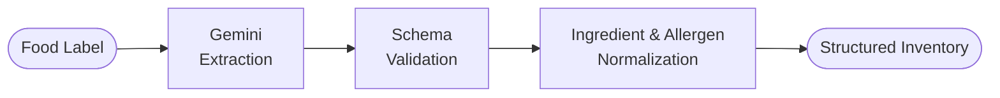

# 🥫 Accessible Food Bank Assistant

Making donated food inventory easier to search and understand with AI.

Accessible Food Bank Assistant is an AI-powered application that transforms food-label information into structured inventory records and helps food bank volunteers discover products through natural-language queries.

Volunteers can ask questions such as:

- Which foods contain soy?
- Find items with more than 10g of protein.
- Which products are low in sugar?
- Which foods contain wheat?

The application searches an existing food inventory, applies dietary and nutritional constraints, and provides responses grounded in retrieved inventory evidence.

🚀 **[Try the Live Demo](https://foodbankassistant.streamlit.app/)**

## Key Features

- **Gemini-powered food extraction:** Extracts ingredients, allergens, and nutrition information from food labels.
- **Structured inventory:** Stores normalized food information and unique inventory identifiers.
- **Hybrid retrieval:** Combines BM25 keyword search with semantic search using Sentence Transformers.
- **Query routing:** Recognizes ingredient, allergen, and nutrition-related queries.
- **Constraint-aware search:** Applies dietary and numeric constraints, including allergen exclusions and nutritional thresholds.
- **Evidence-grounded responses:** Uses Gemini for natural-language answer generation with a deterministic fallback.
- **Streamlit interface:** Provides an interactive interface for searching the existing inventory.
- **Usage safeguards:** Implements session query limits, a daily Gemini generation budget, request timeouts, and read-only public demonstration safeguards.

## How It Works

### Food-label extraction



**Note:** Image-based inventory intake is outside the scope of the public demonstration. The extraction pipeline is implemented and evaluated separately.

### Natural-language search


The Query Router identifies ingredient, allergen, and nutrition-related queries.

The retrieval pipeline combines BM25 and semantic search, followed by Reciprocal Rank Fusion (RRF) and constraint filtering.

Gemini optionally generates a natural-language response using retrieved evidence. When generation is disabled or unavailable, the application uses a deterministic response formatter without requiring an LLM.

### Main Components

| Component | Purpose |
|---|---|
| Google Gemini API | Food-label extraction and optional answer generation |
| BM25 | Keyword-based retrieval |
| Sentence Transformers | Semantic embeddings using `all-MiniLM-L6-v2` |
| ChromaDB | Persistent vector storage |
| Reciprocal Rank Fusion | Combines keyword and semantic rankings |
| Constraint Filters | Applies ingredient, allergen, and nutrition constraints |
| Streamlit | User-facing application |
| Pytest | Automated testing |

## Evaluation

The project has been evaluated across food-label extraction, query routing, retrieval quality, response latency, and synthetic database scaling.

### Food-label Extraction and Retrieval

| Component | Metric | Result |
|---|---|---:|
| Gemini 3.5 Flash Lite | Ingredient Extraction F1 | 0.7950 |
| Gemini 3.5 Flash Lite | Allergen Detection F1 | 0.7527 |
| Gemini 3.6 Flash | Ingredient Extraction F1 | 0.8404 |
| Query Router | Accuracy | 100% |
| Hybrid Retrieval | Precision@5 | 0.9600 |
| Hybrid Retrieval | Recall@5 | 0.5073 |
| Hybrid Retrieval | MRR@5 | 1.0000 |
| Hybrid Retrieval | nDCG@5 | 0.9723 |

Metrics reflect the corresponding evaluation datasets and relevance judgments.

### Synthetic Database Scaling Study

A synthetic database scaling experiment evaluated retrieval performance at increasing inventory sizes.

**Experimental configuration:**

- Dataset sizes: 1,000, 2,500, 5,000, and 10,000 records.
- Queries: 10 representative natural-language queries.
- Benchmark runs: 20 per query.
- Warmup runs: 3.
- Retrieval methods: BM25, semantic search, and hybrid retrieval.
- Embedding model: `all-MiniLM-L6-v2`.
- Vector database: ChromaDB.
- Hybrid ranking: Reciprocal Rank Fusion (RRF), k=60.
- Gemini answer generation excluded.

**Average query latency (milliseconds):**

| Inventory Size | BM25 | Semantic | Hybrid |
|---:|---:|---:|---:|
| 1,000 | 1.30 | 19.42 | 23.45 |
| 2,500 | 1.41 | 5.85 | 8.49 |
| 5,000 | 3.07 | 5.84 | 9.90 |
| 10,000 | 7.60 | 6.85 | 16.92 |

**Index construction and storage:**

| Inventory Size | BM25 Build | Semantic Build | ChromaDB Storage |
|---:|---:|---:|---:|
| 1,000 | 46 ms | 21.74 s | 9.40 MB |
| 2,500 | 97 ms | 41.54 s | 14.02 MB |
| 5,000 | 79 ms | 49.47 s | 28.09 MB |
| 10,000 | 304 ms | 99.02 s | 52.26 MB |

**Observations:**

- BM25 retrieval remained relatively fast as inventory size increased.
- Hybrid retrieval required additional processing compared with BM25 alone.
- Semantic index construction time and storage requirements increased with dataset size.
- Query latency did not increase uniformly across all dataset sizes.
- The 1,000-record semantic and hybrid measurements were higher than those at larger sizes.

**Limitations:**

Synthetic records were derived from existing inventory records with variations in nutritional values. They do not represent independently collected real-world food products.

Synthetic records did not have independent human relevance judgments. Precision calculations use only retrieved records with available human labels, and judgment coverage is reported separately.

All scaling experiments used isolated ChromaDB indexes. Production inventory and production vector storage were not accessed or modified.

These measurements represent local benchmark performance, not deployed Streamlit Cloud performance.

## Technology Stack

- **Language:** Python 3.12
- **Generative AI:** Google Gemini API
- **Retrieval:** BM25, Sentence Transformers, Reciprocal Rank Fusion
- **Vector Database:** ChromaDB
- **Data Processing:** NumPy
- **Application:** Streamlit
- **Testing:** Pytest
- **Version Control:** Git and GitHub

## Run Locally

### 1. Clone the repository

```bash
git clone https://github.com/ANIRUDH-R2911/accessible-food-bank-assistant.git
cd accessible-food-bank-assistant
```

### 2. Create and activate the virtual environment

The project has been validated with Python 3.12.

```powershell
py -3.12 -m venv venv
.\venv\Scripts\Activate.ps1
```

### 3. Install dependencies

```bash
python -m pip install --upgrade pip
pip install -r requirements.txt
pip install -r requirements-dev.txt
```

### 4. Verify installation

```bash
python --version
pip check
```

Expected Python version: Python 3.12.x.

### 5. Configure environment variables

Create a `.env` file in the project root:

```env
GEMINI_API_KEY=your_gemini_api_key
GEMINI_ANSWER_GENERATION_ENABLED=false
```

Set `GEMINI_ANSWER_GENERATION_ENABLED=true` to enable Gemini-powered answer generation.

Keep your API key private and never commit the `.env` file.

### 6. Launch the application

```bash
python -m streamlit run app/streamlit_app.py
```

### 7. Run the automated tests

```bash
python -m pytest tests/ -v --ignore=tests/test_gemini_pipeline.py
```

The Gemini pipeline integration test is excluded from the default test run because it requires a valid Gemini API key and can modify persistent inventory data.

Run it separately only when intentionally testing the live extraction pipeline:

```bash
python -m pytest tests/test_gemini_pipeline.py -v
```

## Deployment

The application is deployed using Streamlit Community Cloud and connected to GitHub for source control.

The public application is configured for read-only inventory searches.

Deployment safeguards include:

- Automatic inventory index initialization when required.
- Reuse of an existing populated ChromaDB collection.
- Cached application initialization to avoid unnecessary re-indexing.
- Gemini answer generation disabled by default.
- Session-level query limits and daily Gemini generation budgets.
- No public image-upload workflow that modifies persistent inventory records.

## Reliability and Safety

- Limits user query length and the number of queries allowed per session.
- Applies a daily generation budget to manage Gemini API usage.
- Configures request timeouts and avoids repeated SDK retries.
- Grounds generated responses in retrieved inventory evidence.
- Handles missing nutritional information without assuming values.
- Separates public inventory search from the food-label extraction workflow.
- Uses isolated databases for synthetic scaling experiments.

## Project Goal

Food banks manage diverse donated inventories, and finding products that meet specific nutritional or allergen requirements can take time.

This project applies Generative AI, information retrieval, and structured data processing to make inventory discovery more accessible and practical for food-bank volunteers and the communities they serve.
